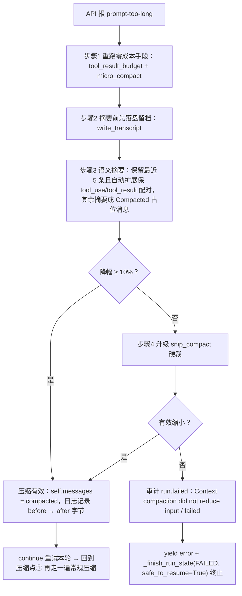
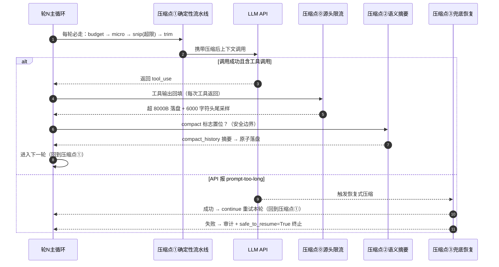

# 上下文压缩参考手册

> **本文件由旧对话归档恢复重建（2026-10-30）**。原始对话（2026-10-12 ~ 10-21）随旧电脑损坏丢失，本文依据云端恢复的三份归档《recovered_share_20261012_全面了解项目代码结构》《recovered_share_20261015-18_工具权限与PG迁移》《recovered_share_20261018-21_PG迁移与简历量化》中的表格与流程描述重建。归档未覆盖的内容标注"（待补充）"，未做任何编造。所有数字以归档原文为准。
>
> 本手册是**详表版**参考：表格、代码锚点、mermaid 图。口语话术版见 [interview-script.md](interview-script.md)「上下文模块」；优化过程的完整时间线数据见 [optimization-log.md](optimization-log.md)。

---

## 目录

1. [压缩体系总览：四层递进](#1-压缩体系总览四层递进)
2. [三个压缩点：触发时机与设计理由](#2-三个压缩点触发时机与设计理由)
3. [压缩点⓪：工具输出源头限流](#3-压缩点工具输出源头限流)
4. [压缩点①：每轮确定性压缩流水线](#4-压缩点每轮确定性压缩流水线)
5. [压缩点②：compact 工具与延迟语义压缩](#5-压缩点compact-工具与延迟语义压缩)
6. [压缩点③：恢复式压缩 recover_context_overflow](#6-压缩点恢复式压缩-recover_context_overflow)
7. [单轮执行时序图](#7-单轮执行时序图)
8. [run 状态机与安全点](#8-run-状态机与安全点)
9. [yield 事件状态机](#9-yield-事件状态机)
10. [持久化架构梳理（归档 3）](#10-持久化架构梳理归档-3)
11. [产物数据可读性与评估框架（归档 3）](#11-产物数据可读性与评估框架归档-3)
12. [迁移与备份速查（归档 2/3）](#12-迁移与备份速查归档-23)
13. [待补充清单](#13-待补充清单)

---

## 1. 压缩体系总览：四层递进

> 最初（2026-10-12）归档口径是"三级压缩链：大结果持久化落盘 → micro_compact → snip_compact → LLM 摘要，prompt 过长自动恢复最多 2 次"。2026-10-15 修复大结果落盘问题后，最终口径演进为**四层递进**：源头限流 → 确定性裁剪 → 语义摘要 → 被动兜底。本文按最终口径组织。

### 1.1 四层总表

| 层 | 方法 | 做什么 |
|---|---|---|
| 0 源头限流 | 工具输出落盘 + 头尾采样 | 输出超 8000 字节写文件，回填历史只留 6000 字符头尾；高频工具输出上限 50KB→8KB |
| 1 常规压缩 | `tool_result_budget` / `micro_compact` / `snip_compact` / `trim_by_size` | 回填预算 → 保最近 3 条、旧工具输出占位符化 → 超 CONTEXT_LIMIT 裁最旧 → 字节硬闸 120000 |
| 2 语义压缩 | `compact_history` | LLM 摘要式全量压缩 |
| 3 反应式压缩 | `recover_context_overflow` | API 报超长后的恢复式压缩 |

### 1.2 压缩方法清单（归档 2026-10-15 22:51 核对版，5 个方法）

| 方法 | 干什么 |
|---|---|
| `tool_result_budget` | 工具输出超 8000 字节先落盘，回填历史时截到 6000，头尾采样保关键信息 |
| `micro_compact` | 只保最近 3 条完整，更早的工具输出替换成占位符 |
| `snip_compact` | 超 CONTEXT_LIMIT 按条数裁掉最旧消息 |
| `trim_by_size` | 字节级硬闸，保证最终不超 120000 字节预算 |
| `compact_history` / `recover_context_overflow` | LLM 摘要式压缩（主动 / 兜底两个入口） |

### 1.3 触发条件表

| 层 | 触发条件 | 成本 |
|---|---|---|
| 0 | 每次工具返回，超阈值即触发 | 零（纯文件 IO） |
| 1 | 每轮调 API 前**必走**（snip 仅超限时触发） | 近零，确定性 |
| 2 | **模型主动调 `compact` 工具**，只置标志，推迟到安全边界执行 | 一次 LLM 摘要 |
| 3 | API 返回 prompt-too-long **异常才触发**，限重试次数 | LLM 压缩 + 重试 |

**为什么这样设计**（归档原话，四条）：

- **按成本递进**：便宜的永远先跑，贵的按需触发，兜底只留给意外——零成本手段消化 90% 的膨胀
- **压缩权分层**：日常裁剪是确定性规则（可预测、可测试）；"哪些信息值得留"这种语义判断交给模型（第 2 层）
- **第 2 层延迟到安全边界执行**：等本轮 tool_use/tool_result 配对完整回填后才压缩并落盘——压缩后的状态一定自洽，和崩溃恢复"只在无工具在途的安全点续跑"是同一设计思想
- **第 3 层失败即留痕**：三次失败出口全部 `run.failed` 审计 + `safe_to_resume=True`，问题可追溯、可恢复

> 追问"为什么不直接全用 LLM 摘要"（归档原话）：每轮摘要又要花钱花时间，且摘要本身有损——确定性截断管日常，语义压缩管该管的时候，兜底只留给意外。

---

## 2. 三个压缩点：触发时机与设计理由

> 归档 2026-10-15 22:46 的经典一问："loop 里面是不是只有两次关于上下文压缩的？"——答案是**三次**（加上源头限流共四个位置），漏掉的那次恰好是设计上最有趣的一处。

| 压缩点 | 位置 | 触发方 | 手段 | 成本 |
|---|---|---|---|---|
| ⓪ 源头限流 | 每次工具返回 | 系统 | 超 8000B 落盘 + 6000 头尾采样 | 零（纯文件 IO） |
| ① 常规 | 每轮调 API 前（pipeline.py L307） | 系统，每轮必走 | `_compact_if_needed`（context_manager.py L115-120）四步确定性流水线：`tool_result_budget` → `micro_compact` → 超 `CONTEXT_LIMIT` 时 `snip_compact` → `trim_by_size(CONTEXT_BYTES_BUDGET)` | 近乎零 |
| ② 语义 | 工具结果回填完的安全边界（pipeline.py L592-598） | **模型自己**调 compact 工具 | 只置 `_pending_compaction = True`，返回 "scheduled for next safe boundary"；真正执行在工具结果全部回填、user 消息拼完整之后跑 `compact_history()`（LLM 摘要式全量压缩），随 `_persist_run_safe("model")` 原子落盘 | 一次额外调用 |
| ③ 兜底 | API 真报 prompt-too-long | 被动触发 | `recover_context_overflow` + 失败审计（见第 6 节） | 最后防线 |

**设计理由**（归档原话）：

1. ②里"只置标志、推迟到工具结果回填完再压缩"这个细节特别值得讲：**压缩发生在安全边界，避免把一轮未完成的 tool_use/tool_result 配对拦腰截断**——这和恢复机制里"只在无工具在途的安全点续跑"是同一个设计思想
2. 三层按"廉价→昂贵、主动→被动、确定性→语义"递进；加源头限流后是"**源头限流 → 确定性裁剪 → 语义摘要 → 被动兜底**"，越靠前越便宜、越靠后越昂贵

> 注：`compact` 工具由 Agent 自己注册（integrations.py L34-43），属于业务类工具（见 tool-reference.md 第 1 节）。

---

## 3. 压缩点⓪：工具输出源头限流

> 归档 2026-10-15 22:56："今天改的那个关于返回结果太长导致的上下文太长"——压缩体系的第 0 层，位置在所有压缩之前。

### 3.1 问题现象与三个叠加根因

**现象**：让 agent 部署项目，约 30 轮后思考时间明显变长、token 暴涨，单 run 花约 ¥3。

**为什么会出现**（三个叠加根因）：

1. 工具输出用 `str(output)` **原文回填** messages——SSE 给用户看的是截断版，但历史里是全文，"**看到的不等于发出去的**"
2. 部分工具输出上限 50KB，一条命令就能塞 15 万字符
3. 字节预算闸口生效在回填**之后**，拦不住单轮尖峰

### 3.2 怎么排查出来的（归档强调"面试重点讲这段"，三步）

1. 从 `app.log` 提取每轮 `[turn N] ctx=xxx` 画曲线 → 发现不是线性劣化，而是**周期性尖峰** → 排除泄漏，指向"某类消息突然变大"
2. 对照同轮工具调用日志 → 尖峰全部紧跟大输出工具（bash 等）→ 锁定工具输出回填
3. 给 `_call_api` 挂上 `response.usage` 真实记账（`[usage]` 日志）→ 顺带发现 `cache_read=0`：micro_compact 每轮重写中部占位符破坏了前缀，缓存全 miss——又找到下一个优化点（前缀稳定化）

### 3.3 修复参数与验证数据

| 参数/改动 | 值 |
|---|---|
| `PERSIST_THRESHOLD` | 8000（超 8000 字节落盘成文件，需要时 agent 可读文件） |
| `HISTORY_TOOL_LIMIT` | 6000（回填历史只留 6000 字符头尾采样 `head...tail`，保留开头结论和结尾状态） |
| `CONTEXT_BYTES_BUDGET` | 120000（字节级硬闸） |
| shell 等高频工具输出上限 | 50000 → 8000 |

**验证**（同负载复跑，部署任务）：ctx 峰值 246,422 → 47,763（**-80.6%**）、单 run 成本 ¥3 → ¥0.86（**-71%**）、API 最大耗时 114s → 8s。

> 一句话收束（归档原话）：这个问题体现了完整闭环——日志埋点发现异常曲线 → 对照定位根因 → 修复在源头而非症状处 → 同负载复测用数据证明效果 → 顺带挖出下一个优化点。

---

## 4. 压缩点①：每轮确定性压缩流水线

`_compact_if_needed` 定义在 context_manager.py L115-120，**每轮必走、不调 LLM、廉价**，内部四步顺序固定：

| 顺序 | 步骤 | 动作 |
|---|---|---|
| 1 | `tool_result_budget` | 工具输出回填预算控制（与⓪配合：超 8000B 落盘，回填截到 6000 头尾采样） |
| 2 | `micro_compact` | 只保最近 3 条完整，更早的工具输出替换成占位符 |
| 3 | `snip_compact` | 仅当超 CONTEXT_LIMIT 触发：按条数裁掉最旧消息（CONTEXT_LIMIT = 50000，config.py L118） |
| 4 | `trim_by_size(CONTEXT_BYTES_BUDGET)` | 字节级硬闸，保证最终不超 120000 字节 |

**顺序逻辑**（归档原话）：便宜的永远先跑；snip 是超限才走；trim 收尾兜底。归档 2026-10-12 早期描述还有"snip_compact（保头尾+保 tool_use/result 配对）"一说，后核对版口径为"按条数裁掉最旧消息"——两处归档描述略有出入，配对保护在恢复式压缩（第 6 节）中是明确实现的（保留最近 5 条且自动扩展）。

---

## 5. 压缩点②：compact 工具与延迟语义压缩

Agent 注册了一个叫 `compact` 的工具（integrations.py L34-43）——模型判断历史太长时可以**主动调用它**：

```
模型调 compact 工具
  → 只把 _pending_compaction = True
  → 返回 "scheduled for next safe boundary"   ← 此刻不压缩
       │
       ▼（本轮工具结果全部回填、user 消息拼完整之后）
pipeline.py L592-598：
  if self._pending_compaction:
      self.messages = compact_history(...)     # LLM 摘要式全量压缩
  self._persist_run_safe("model")              # 原子落盘
```

**关键细节**（归档原话）：压缩发生在安全边界，避免把一轮未完成的 tool_use/tool_result 配对拦腰截断；压缩后落盘的 messages 一定自洽，崩溃恢复拿到的就是压缩后的干净状态。

> 归档 2026-10-12 一轮的描述："模型判断历史太长时可以主动调用它……真正执行在 L555：等本轮工具结果全部回填、user 消息拼完整之后，才跑 compact_history()，然后随 _persist_run_safe('model') 一起原子落盘。"

---

## 6. 压缩点③：恢复式压缩 recover_context_overflow

> 触发条件：API 真报 prompt-too-long 才走，限重试次数（归档 2026-10-12 口径为"最多重试 2 次"）。实现在 error_recovery.py L83-110。

### 6.1 四步流程（归档 2026-10-15 23:14 核对版，四个要点）

1. **先重跑零成本手段**（`tool_result_budget` + `micro_compact`）——不急着动用贵的
2. **语义摘要前先落盘留档**（`write_transcript`）——压缩是破坏性的，先留证据再压
3. **保留最近 5 条且自动扩展**保住 tool_use/tool_result 配对，其余摘要成一条 `Compacted` 占位消息
4. **降幅不足 10% 判定无效**，升级 `snip_compact` 硬裁；再无效就审计终止

### 6.2 mermaid 流程图（按归档文字描述重画）



### 6.3 主循环侧的恢复编排（归档保留的代码片段要点）

- 重试有上限：超过后 `_audit("run.failed", "context recovery exhausted", safe_to_resume=True)` 并 return
- 每次触发：`yield {"type": "status", "message": "Prompt 过长，执行上下文恢复压缩..."}` + `logger.warning("[turn N] Prompt 过长，执行 recover_context_overflow")`
- 压缩调用：`compacted, stats = recover_context_overflow(self.messages, self.client, self.recovery.current_model)`
- 压缩失败（异常）：`_audit("run.failed", "Context compaction failed", severity=SEVERITY_HIGH)` → yield error → 终止（`safe_to_resume=True`）
- 压缩成功：`self.messages = compacted`；日志 `[turn N] context recovery: {stats['before']} -> {stats['after']} bytes`；`stats["reduced"]` 为假则按无效处理终止
- **`continue` 重试同一个 turn**（turn 计数在 for 里未递增前就 continue），恢复后重新过一遍常规压缩——不是绕过常规压缩，而是恢复后再走正常流程

> 面试点睛（归档原话）："兜底压缩也遵守'便宜先行'——确定性手段重试在前，LLM 摘要在中，硬裁在后，每一步都有有效性校验，无效就往上升级、最终失败留痕可恢复。"

---

## 7. 单轮执行时序图

> 归档 2026-10-15 22:55 + 23:09 两轮整理的"一次 turn 内的执行时序"，当年为 ASCII 文字图，按原样重画为 mermaid。



**顺序设计的三条逻辑**（归档原话）：

1. **便宜的永远先跑**：①每轮无条件前置，成本近零；②③都贵，只按需触发
2. **语义压缩踩在安全边界**：②固定在"工具结果回填完毕、落盘之前"这个点执行——保证压缩后落盘的 messages 一定自洽
3. **兜底失败会回流**：③成功后 `continue` 回到本轮重试，重新过一遍①——不是绕过常规压缩，而是恢复后再走正常流程

口诀：**源头限流 → 确定性裁剪 → 语义摘要 → 被动兜底**；便宜先行、贵者按需、异常回流。

---

## 8. run 状态机与安全点

> 归档 2026-10-12（yield 状态机一轮）的 run 记录层面状态机，与压缩体系的安全点/续跑语义直接相关。

```
running ──正常完成──► completed
   │
   ├──yield error──► failed      (safe_to_resume=True，可续跑)
   ├──用户取消──► canceled
   └──进程被kill──► interrupted   (重启时 interrupt_stale_runs 兜底)
```

**safe_to_resume 翻转节奏**：

```
调工具前 → False  ──────────► 每轮末尾 persist_run_safe → True
审批等待中 → False (waiting_approval)
```

与压缩的交汇：prompt 过长恢复路径的三类终止全部 `safe_to_resume=True`（异常发生在模型调用阶段，**没有工具在途**，可安全续跑）；而 ② 语义摘要固定打在 `_persist_run_safe("model")` 同一个安全点上。

---

## 9. yield 事件状态机

> 归档 2026-10-12 21:56："请详细解释 Agent 内部生成器中 yield 事件的具体逻辑和状态机流转"——`_run_stream_impl`（pipeline.py L209-637，429 行）是"整个项目的核心心脏"。

### 9.1 七种事件总表

| 事件 | 触发时刻 | 前端反应 |
|---|---|---|
| `status` | 每个阶段切换（压缩/调模型/等审批…） | 更新状态栏文字 |
| `thinking` | 每轮开始调模型前 | 显示"第 N 轮：思考中" |
| `tool_use` | 工具执行**前** | 轨迹面板加一行 running |
| `tool_result` | 工具执行**后** | 该行变 done + 显示输出 |
| `text_delta` | 拿到最终回复后按词模拟 | 打字机效果 |
| `pending_action` | 工具需审批时 | 弹审批卡片 |
| `done`/`cancelled`/`error` | 终态 | 收尾处理 |

补充细节（归档同轮）：

- `text_delta` 不是模型 token 级流式（SDK 拿到完整响应），而是拿到完整回复后按空格拆词逐个 yield 的"伪流式"
- yield 给前端的 `tool_result.output` **截断 2000 字符**防刷屏；回填进 `results` 给 LLM 的是**完整 output**——"给前端和给 LLM 的是两份数据"
- 事件格式：`yield {"type": ..., "message": ..., "turn": n}`

### 9.2 全流程状态机（文字版，归档原样）

```
新run ──► 初始化 ──► 准备中 ──► [50轮循环] ──► done
              │                                    │
   resume=True 走快照分支                final_text 兜底查找
                                        _finish_run_state(COMPLETED)

[50轮循环] 内每轮：
  ①取消检查 ──► ②压缩 ──► ③thinking ──► ④调LLM ──┬─异常─► 恢复/报错退出
                                                │
                                        ⑤有tool_use？
                                          ├─否─► 逐词yield text_delta ──► break
                                          └─是─► 逐工具执行 ──► 回填 ──► 下一轮
```

**_call_api 的异常分级处理**（pipeline.py L319-445，与压缩直接相关）：

- **Prompt 过长**：最多重试 2 次。每次 yield status"执行上下文恢复压缩"→ `recover_context_overflow` 压缩 → `continue` 重试本轮。压缩后仍超限或压缩无效 → yield `error` + `_finish_run_state(FAILED, safe_to_resume=True)` + return
- **输出 token 超限**：`escalate_tokens` 把 8000 扩到 16000 → `continue` 重试（**不消耗压缩次数**）
- **其他异常**（网络/429 重试耗尽等）：直接 error 退出；`safe_to_resume=True`——异常发生在模型调用阶段，没有工具在途

**三个取消检查点**：轮首、API 返回后、每个工具执行前。第三个最讲究——取消时把**尚未执行的剩余工具**补上 `"Error: cancelled by user"` 的 tool_result 再退出，保证 assistant 的 tool_use 和 user 的 tool_result 严格配对，不破坏消息序列。

**工具块执行序列**（压缩相关部分）：`yield tool_use` → `_mark_run_unsafe(block.name)` → `_handle_tool_call(block)`（需审批则 yield `pending_action` + 阻塞 `_await_tool_approval` 最长 1800s）→ `yield tool_result`（截断 2000）→ 完整 output 回填 → 若 `_pending_compaction` 则 `compact_history()` → `_persist_run_safe("model")` 安全点。

### 9.3 SSE 三层链路（简述）

```
Agent 生成器 yield dict
  → event_generator 包成 "data: {...}\n\n" 字符串（StreamingResponse + text/event-stream
    + X-Accel-Buffering: no 禁代理缓冲 + session-id 响应头）
  → 前端 fetch + reader.read() 读字节 → buffer 攒半帧 → split('\n\n') 切完整帧
  → JSON.parse 后按 type 更新 UI（轨迹面板/打字机效果）
```

为什么不用 EventSource：只支持 GET，无法 POST 消息体。`run_lock` 保证同一 session 并发第二条消息阻塞等待。详版见 interview-script.md「流式输出模块」。

---

## 10. 持久化架构梳理（归档 3）

> 归档 3（2026-10-19）对 PG 迁移后新代码的全库分层讲解。压缩产物（大输出文件、transcript）的最终去向也在这一节。

### 10.1 PG-only 改造：删了什么（归档 2，2026-10-18 19:38）

| 删掉的 | 原来负责什么 | 现在谁接管 |
|---|---|---|
| `agent/platform/storage.py` | JSON 文件读写（atomic_write_json 等） | 没有了，直接调 PG repository |
| `agent/persistence/writer.py` | 双写到 PG | 没有了，Store 直接调 repository |
| `agent/persistence/routing.py` | 按域切读 | 没有了，全部读 PG |
| `agent/persistence/views.py` | 影子校验 | 没有了 |
| `agent/persistence/consistency.py` | 一致性检查 | 没有了 |
| 4 个迁移脚本 | JSON→PG 数据导入 | 后来为服务器旧数据又重写了 `migrate_legacy_json.py`（幂等 upsert） |
| 6 个测试文件 | 双写/路由/影子/存储测试 | 不需要了 |

配置精简：`.env` 只需 `DATABASE_URL`；`PERSISTENCE_BACKEND`/`PERSISTENCE_READ`/`PERSISTENCE_SHADOW` 全删。

### 10.2 调用分层：粘合层 → 领域门面 → Repository（Q：怎么将输出通过 SQLAlchemy 存进 PG）

```
pipeline.py (Agent 主循环)
  └─ RuntimePersistenceMixin  core/persistence.py   ← 粘合层：把"当前状态"翻译成 store 调用
       └─ RecoveryStore  sessions/state_store.py     ← 领域门面：组装记录 + 序列化
            └─ repositories/runs.py · sessions.py · usage.py · audit.py …
                 └─ common.py  upsert_row / update_row_if_version   ← SQLAlchemy 原语
                      └─ session_scope()  persistence/database.py  ← 事务边界 → PostgreSQL
```

关键点（归档原话）：**pipeline 不认识 SQL**，它只说"我现在到哪个阶段了"；SQL 只在最底层的 repository 里出现。

粘合层五个方法（core/persistence.py L12-80）：`_persist_session_state` 只写会话；`_persist_run_state` 先写会话再写 run——**所以 run 与它的消息快照永远同一次调用落库**。

### 10.3 六层流水线（以 targets 域为例，其余 8 个业务域结构一模一样）

| 层 | 文件 | 职责 | 产出 |
|---|---|---|---|
| 0 建表 | `alembic/versions/000X_*.py` | DDL 版本化 | PG 里真实的表 |
| 1 映射 | `persistence/models.py` | 表 ↔ Python 类 | `TargetRecord` |
| 2 仓储 | `repositories/targets.py` | **唯一写 SQL 的地方** | `fetch/upsert/delete/count` |
| 3 门面 | `targets/store.py` + `service.py` | 业务组合 + 校验 | `TargetStore().create(...)` |
| 4 接口 | `api/routes/target_route.py` | 协议 + 权限 | `POST /api/targets` |
| 5 前端 | `web/src/*` | 调用 | 页面数据 |

各层要点：

- **层 0 Alembic**：5 个迁移按域拆分（见 10.5）；仅 0001 的 audit_events 一张表 `upgrade()` 就建 8 条索引（含复合索引 `(session_id, occurred_at)` 专为"按会话查审计"设计），5 个迁移累计 86 条；`downgrade()` 精确逆序回收；**生产不用 `Base.metadata.create_all()`**（database.py L97-101 注释写明仅供测试），那个只给单测/eval 的临时 SQLite 库
- **层 1 models**：声明式 `mapped_column`；类型带方言变体 `JSON_VALUE`（PG 用 JSONB/其他库用 JSON）、`BIGINT_PK`（PG 用 BigInteger/SQLite 用 Integer 才能自增）——同一套模型跑两种方言；每个业务表都有 `version` 字段（并发版本号）
- **层 2 repository 三约定**：① 每个出口方法内部 `with session_scope()` 包一个事务，调用方不管连接和提交；② **不抛业务异常**——查不到返回 `None`，写失败返回 `False`，由上层判断语义；③ `upsert_target` 对外一个方法、内部分两条路——不传 `expected_version` 走 `upsert_row`，传了转 `update_row_if_version` 走 CAS，同一张表既能普通写也能乐观锁写
- **层 3 Store + service 职责切分**：Store 管"先做什么再做什么"的组合逻辑（list/create/update/delete，update 是读-合并-写 `{**current, **payload}` 保留 id/created_at），service 管"什么算合法"的纯校验（`normalize_target`：生成 `tgt_` id、service 名 fullmatch 防注入、路径检查）。**Store 里看不到一行 SQL，service 里看不到一次 IO**
- **层 4 API 四件事**：Pydantic 校验入参；权限闸 `Depends(require_permissions(...))`（读接口 `AGENT_CHAT`、写接口 `SESSION_MANAGE`）；调 Store 后 `to_dict()`；异常翻译 `KeyError→404`、`ValueError→400`——repository 层"不抛业务异常"的设计到这里才收口

一句话记住每层（归档原话）：**Alembic** 定结构（不可变的历史）→ **models** 定映射（表↔类）→ **repository** 定读写（全项目唯一的 SQL 层）→ **store/service** 定业务（组合 + 校验）→ **api** 定协议（入参校验、权限、异常翻译）。新增一个域只要照着排 0→4 层，改动是**加法**、不碰主循环。

### 10.4 第 0 层 Alembic 的意义（Q："第零层还是不懂"）

`create_all()` 只做"表不存在就建，存在就不管"：加列不管、改列类型不管、不留痕迹。只适合"每次都是全新空库"的场景（单测临时 SQLite）。**只要库里有了真实数据就绝不能删表重建**，结构变更只能靠 `ALTER`，Alembic 就是管理这些 `ALTER` 的工具。

| 编号 | 干了什么 |
|---|---|
| 0001 | 建审计表 + 用量表（地基） |
| 0002 | 建各业务域表（targets/tasks/task_dependencies/memories） |
| 0003 | 建治理与自动化表（pending_actions/cron_jobs/cron_logs/background_tasks） |
| 0004 | 建会话与运行表（sessions/messages/runs/run_snapshots） |
| 0005 | 建评测表 |

每个文件都是一个 `upgrade()` 配一个 `downgrade()`，靠 `down_revision` 串成链。类比：Alembic ≈ 数据库结构的 git，`upgrade` ≈ `git pull`，`downgrade` ≈ `git revert`。服务器上只需执行一次 `alembic upgrade head`，自动补跑没跑过的迁移。

### 10.5 18 张表清单（models.py）

归档两处提到的表清单（能找到的都列在这里）：

| 链路 | 表 |
|---|---|
| 执行过程 | `runs` / `run_snapshots` / `messages` / `run_usage` |
| 治理 | `pending_actions` / `audit_events` |
| 业务 | `tasks` / `task_dependencies` / `memories` / `cron_jobs` / `cron_logs` / `background_tasks` / `targets` |
| 会话 | `sessions` |
| 评测 | `eval_batches` / `eval_trials` / `eval_tool_calls` / `eval_scores`（归档明确"本次不讲"，结构待补充） |

### 10.6 一次 run 的写入时序（每个节点写什么）

| 时刻 | 调用点 | 写入的表 | 底层写法 |
|---|---|---|---|
| run 开始 | `_audit("run.started")` + `store.create_run()` | `audit_events`、`runs`、`run_snapshots` | upsert_row |
| 每轮模型调用前 | `_persist_run_safe("model")`（pipeline.py L600） | `runs`、`run_snapshots`、`sessions`、`messages` | upsert_row |
| 每次 API 返回 | `_record_usage()`（pipeline.py L131-183） | `run_usage` | **session.add**（追加一行） |
| 执行工具前 | `_mark_run_unsafe()`（pipeline.py L508） | `runs`（`safe_to_resume=False`） | upsert_row |
| run 终态 | `_finish_run_state(...)` | `runs`（`finished_at`/`status`） | upsert_row |

### 10.7 SQLAlchemy 三种写入姿势（repositories/common.py 三个核心原语）

| 姿势 | 函数 | 要点 |
|---|---|---|
| ① 整体镜像式写入 | `upsert_row`（common.py L37-124） | `INSERT ... ON CONFLICT (pk) DO UPDATE`。三个巧思：`set_` 必须引用 `excluded`（本次提交的行）而非字面量——否则 executemany 批量时所有行会被同一份值覆盖；`version = version + 1` 由数据库自增形成修订计数器；`where = is_distinct_from(...)` 只有真有列变化才落库，重放不虚增 version（早期用时间戳判断，漏掉"访问计数变了但 updated_at 没变"的场景）。无 upsert 方言回退 `_merge_row` 读改写，够单测用 |
| ② 纯追加 | `session.add(Model(...))`（usage.py L27-39） | `run_usage` 主键是自增 BIGINT，每轮插一行、无需冲突处理，直接 ORM 追加 |
| ③ CAS 条件更新 | `update_row_if_version`（common.py L127-155） | `WHERE id=? AND version=?`，rowcount=0 说明被别人改过 → 上层重试或报冲突。**审批状态机靠它防并发双批** |

另有 `record_to_dict()`：兼容"dict 或带 to_dict() 的对象"，让 Store 的调用方式跟旧 JSON 时代保持一致。

### 10.8 序列化与两个"不重复写"细节

- **序列化**（state_store.py L92-97 `serialize_messages`）：Agent 手里是 SDK 对象（text/tool_use/tool_result block），不能直接进 JSONB。递归拍平成纯 dict：`tool_use → {type,id,name,input}`，`tool_result → {type,tool_use_id,content}`，其它对象走 `model_dump()` 或 `vars()`，最后兜底 `str()`。读回来时 `deserialize_messages` 还原
- **content_hash 判重**（repositories/runs.py L112-160 `upsert_run`）：对整份消息算 sha256，快照没变就跳过 `run_snapshots` 的写入——run 每轮状态都在变（写 runs 表），但消息快照往往没变，避免每轮重写大 JSONB
- **messages 表按 seq 增量同步**（repositories/sessions.py L110-165 `_sync_messages`）：逐 `(session_id, seq)` 比对 hash，只写变化的行，**多余的 seq 删除**——因为上下文压缩会重写整个历史，不是纯追加

### 10.9 旧 JSON vs PG（本质区别）

| | 旧 JSON | 现在 |
|---|---|---|
| 写入粒度 | 整个文件全量重写 + 文件锁 | 行级 upsert |
| 并发 | 无版本语义，后写覆盖 | `version` CAS + DB 决定谁赢 |
| 一致性 | 多文件间无事务 | `session_scope` 单事务（run 行 + 快照同行提交） |
| 中间层 | 双写 + 影子校验 + 按域切读 | **全删**，Store 直接调 repository |

一句话（归档原话）：**旧 JSON 是"把内存对象 dump 成文件"，现在是"把状态翻译成行级 UPSERT/CAS 交给数据库"**，并发和事务语义从"自己保证"变成"数据库保证"。

**压缩产物在 PG-only 后的去处**：大工具输出仍落盘文件（不入库，查询走文件通道）；压缩瞬间的原件写入磁盘 `.transcripts`（context_compact.py L269-278），也不在 DB——见 11.2 缺口 4/5。

---

## 11. 产物数据可读性与评估框架（归档 3）

### 11.1 18 张表真实可读的数据（Q："如果不手搓用框架能读多少"）

| 链路 | 表 | 读得到什么 |
|---|---|---|
| 执行过程 | `runs` / `run_snapshots` / `messages` | 每一轮 run 状态、阶段、安全点消息快照、完整对话（含 tool_use/tool_result 块） |
| 成本 | `run_usage` | 每轮 token 输入/输出/缓存读写 + 成本估算 |
| 治理 | `pending_actions` / `audit_events` | 审批全字段（payload/steps/影响面/回滚方案/结果）、事件级审计流 |
| 业务 | `tasks` / `task_dependencies` / `memories` / `cron_jobs` / `cron_logs` / `background_tasks` / `targets` | 任务 DAG、长期记忆、定时任务执行输出、后台任务 stdout |
| 评测 | `eval_batches` / `eval_trials` / `eval_tool_calls` / `eval_scores` | 用例批次、试次结果、逐次工具调用、评分 |

### 11.2 确实读不到的 5 个缺口（"不是所有数据可读"是真的，主要是故意设计的取舍）

1. **原始 LLM 请求报文**——只存用量数字 + 解析后的消息，系统提示词快照、完整请求参数没留
2. **模型 thinking 内容**——没落库；pipeline 每轮只 yield 一个 `{"type": "thinking"}` 轮次提示事件（pipeline.py L309），不携带思考正文
3. **审计 payload 被截断 + 脱敏**——audit.py L40-57 单值截到 4000 字符，密码/token 一律 `***`
4. **压缩会重写历史**——上下文压缩把早期工具输出换成摘要，**原件只在压缩瞬间写进磁盘 `.transcripts`**（context_compact.py L269-278），不在 DB
5. **大工具输出落盘不入库**——在磁盘上，查询要另走文件通道

归档建议的补缺方案（未确认是否实施）：复用现有 audit 基建加一张 `trace_events` 表存原始 LLM 响应 + thinking（按 run_id/turn 索引），成本半天，不引入第三方泄露面。

### 11.3 自建 vs 观测框架（LangGraph + LangSmith / Langfuse / OpenAI Agents SDK）对比

- **框架自动给**：span 级 trace——每次 LLM 调用的完整输入输出、每个工具调用、耗时、token，全量明文上报。纯可读性上框架确实更全（尤其原始报文和 thinking）
- **但代价**：trace 存第三方 SaaS 或独立服务，**和业务数据不在一个库** → 一个 run_id 无法 join 审批/任务/记忆/评测；payload 默认原样明文上报，运维目标内容/命令/凭据流到第三方反而是泄露面；trace 是事后观测不参与决策，撑不起跨重启续跑、审批状态机、权限闸

**自建的 4 条优势**（归档原话）：

1. **观测与业务同库同事务**：审计/用量/评测和业务表在一个 PG，一个 `run_id` 能把审批 → 工具 → 成本 → 评测全链路串起来；框架 trace 是外挂的，join 不了
2. **治理内生于数据**：append-only + 脱敏 + 截断是"合规级"设计；框架默认全量明文，安全上是减分
3. **持久化驱动恢复**：`runs`/`run_snapshots`/`pending_actions` 是跨重启的状态源，trace 只是日志，做不到续跑
4. **成本-质量闭环可量化**：`run_usage` + `eval_*` 能算"每个用例的成本和得分"，框架不提供业务级成本归集

一句话话术（归档原话）：框架给你的是"自动的、外挂的、明文的观测"；我手搓的是"可控的、同库的、脱敏的、能驱动恢复的治理"。**框架读的是只能看的数据，我读的是能用的数据。**

---

## 12. 迁移与备份速查（归档 2/3）

### 12.1 服务器 JSON→PG 迁移对账（2026-10-18，零漂移）

| 业务域 | 条数 |
|---|---|
| 审批动作 pending_actions | 678 |
| 执行记录 runs（含消息快照） | 222 |
| 后台任务 background_tasks | 197 |
| 会话 sessions（消息 292 条） | 6 |
| 运维目标 targets | 4 |
| 任务 tasks | 5 |
| 定时任务 cron | 1 个 job + 9 条日志 |
| 长期记忆 memories | 2 |

过程中踩的坑：旧数据混有 NUL（\u0000）字符（此前 shell 事故的脏数据），PG 的 text/JSONB 拒绝写入导致 actions/background/runs 首次导入失败，迁移脚本加**递归清洗**后重跑成功；脚本幂等可重跑（upsert）。

### 12.2 备份体系

| 要素 | 做法 |
|---|---|
| 方式 | pg_dump 逻辑备份（数据量小，8 个域不到 50 条级别即可覆盖；pg_basebackup 留给大库增量场景） |
| 频率 | 每天 03:00 crontab（/etc/cron.d/ai-devops-pg-backup） |
| 保留 | 最近 7 天自动清理 |
| 异地 | dump + 旧 JSON 快照 tar 包拉回本地一份（.gitignore 防误提交） |
| 演练 | "备份了但没做过恢复演练 = 没备份"；恢复用 `pg_restore -d ai_devops <dump>`（先空库演练） |
| 基线 | 迁移完成当晚基线 dump 3.6MB |

### 12.3 本地连接速查

- 隧道：`ssh -N -L 15432:127.0.0.1:5432 ubuntu@<服务器>`（IP 归档已脱敏），或 DBeaver 内置 SSH 隧道 + Keepalive interval 30s
- 客户端：DBeaver Community（推荐）/ psql / VS Code Database Client；连接 `127.0.0.1:15432`，库 `ai_devops`
- 常用口径 SQL：调用分布查 `audit_events` 按 `tool_name` 分组；审批历史按 `pending_actions.action_code` 分组；审批等待用 `confirmed_at - created_at`

---

## 13. 待补充清单

| 内容 | 归档中的线索 |
|---|---|
| `snip_compact` 的 CONTEXT_LIMIT 具体数值 | 归档未给；已从代码核实 **50000**（config.py L118） |
| `micro_compact` 占位符的具体文本格式 | 归档未展开；代码为 `[Earlier tool result compacted.]`（context_compact.py L258/263） |
| "前缀稳定化"优化的具体实现 | 归档提到 cache_read=0 引出该优化点，实现细节未展开（见 3.2） |
| `compact_history` 摘要提示词与摘要结构 | 归档未展开 |
| 4 个 eval_* 评测表结构 | 归档明确"本次不讲"（10.5 注）；迁移 0005 实建 4 张（eval_batches/eval_trials/eval_tool_calls/eval_scores） |
| `run_usage` 的模型单价常量数值 | 归档只说"按模型单价配置"；代码为 PRICE_INPUT_PER_M=2.0 / PRICE_OUTPUT_PER_M=8.0 / PRICE_CACHE_HIT_PER_M=0.5（config.py L126-128） |
| messages/runs 等表完整字段 DDL | 归档只给表名与关键设计（BIGINT_PK/version/content_hash），未逐列展开 |
| 评估框架（用例批量回归 + 规则评分 + LLM 判分 + 基线对比）内部结构 | 归档仅在简历量化里点名，未展开 |
| 五段式 system prompt 的五段内容 | 归档 2026-10-12 项目全貌仅点名"五段式" |
| `.transcripts` 落盘文件的目录组织与清理策略 | 归档只提"压缩瞬间写入"（11.2） |

---

*重建完成于 2026-10-30。数字与代码锚点均出自归档原文；如与当前代码不一致，以代码为准并回改本文。*
