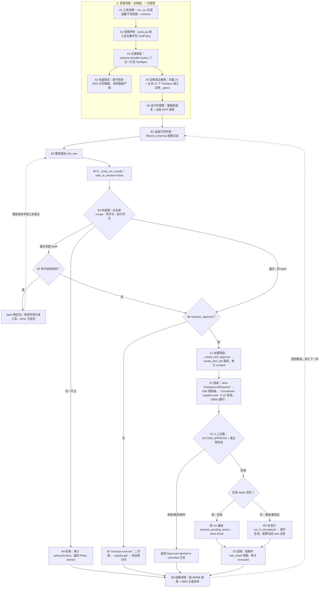

# 工具体系参考手册

> **本文件由旧对话归档恢复重建（2026-10-30）**。原始对话（2026-10-15 ~ 10-16）随旧电脑损坏丢失，本文依据云端恢复的对话归档《recovered_share_20261015-18_工具权限与PG迁移》与《recovered_share_20261012_全面了解项目代码结构》中的表格与流程描述重建。归档未覆盖的内容标注"（待补充）"，未做任何编造。
>
> 本手册是**详表版**参考：表格、代码锚点、行级细节。口语话术版见 [interview-script.md](interview-script.md)「工具系统模块」；治理效果的完整优化数据见 [optimization-log.md](optimization-log.md)。

---

## 目录

1. [六类工具总表](#1-六类工具总表)
2. [工具注册：三条路线对照表](#2-工具注册三条路线对照表)
3. [权限绑定机制：四步打包（以 bash 为例）](#3-权限绑定机制四步打包以-bash-为例)
4. [ToolPolicy 静态字段与运行时四道闸](#4-toolpolicy-静态字段与运行时四道闸)
5. [权限求值点全景](#5-权限求值点全景)
6. [实例级 tool_registry 与运行时视图](#6-实例级-tool_registry-与运行时视图)
7. [handle_tool_call 与 execute 的双重 evaluate](#7-handle_tool_call-与-execute-的双重-evaluate)
8. [工具全生命周期大表](#8-工具全生命周期大表)
9. [补遗分支（对照源码核出的遗漏）](#9-补遗分支对照源码核出的遗漏)
10. [bash 确定性重定向（成本闸门）](#10-bash-确定性重定向成本闸门)
11. [审批全流程](#11-审批全流程)
12. [治理效果数据](#12-治理效果数据)
13. [待补充清单](#13-待补充清单)

---

## 1. 六类工具总表

> 来源：归档 1 末轮（2026-10-15T23:21，"这个项目有几种类型的工具……"）。当时核对完代码并写入面试话术的最终口径。

| 类型 | 位置 | 权限特征 |
|---|---|---|
| 文件类 | `file_tools.py` | read 免批，write/edit MEDIUM，**强制沙箱**（仅注册进子代理注册表，不在主 Agent 的 45 个之内） |
| Shell 类 | `shell.py` | bash = HIGH + 需审批 + 确定性拦截重定向 |
| Ops 观测类 | `ops.py` | 13 个全 READ_ONLY 免批 |
| Target 远程类 | `agent/targets/tools.py` | SSH 远程，restart=HIGH、deploy=**CRITICAL** |
| 业务类 | `tools/business/` | 任务/记忆/技能/子代理/compact/cron |
| MCP 动态类 | 运行时挂载 | 策略按工具名正则推断 |

**核心设计思想：元数据先行 + 默认拒绝**（`policy.py`）：

1. 每个工具静态声明 `ToolPolicy`（风险级五档、scope、是否需审批、幂等性、超时…）
2. 运行时 `evaluate_tool_policy` 过闸（见第 4 节）：需审批的生成 pending action 暂停等人批
3. **可见性同源**：模型能看到的工具列表用同一套决策过滤——没权限的工具模型根本看不见，不是"看到但被拒"
4. **默认拒绝**：未知工具一律 HIGH + 需审批；配错策略（read_only 配了非 READ_ONLY 风险级）启动时就 ValueError

> 面试点睛句（归档原话）："**工具能不能注册**和**工具有没有权限**是解耦的两层——注册只管元数据齐全，权限独立声明，宁可误拦不可漏放。"

---

## 2. 工具注册：三条路线对照表

| 来源 | 注册点 | 例子 |
|---|---|---|
| 内置工具 | 模块级定义 → `__init__.py` 聚合 → `ToolRegistry.builtin()` | bash / target_* 工具（file 四件套不在 `ALL_TOOL_SCHEMAS` 内，仅注册进子代理） |
| 业务工具 | `BusinessRegistrationMixin` 实例化时动态 register | `spawn_subagent`、`compact`、automation/memory/tasks |
| MCP 外部工具 | `assemble_tool_pool` 运行时快照挂载 | 每次调 LLM 前现拼 |

**路线 A（内置四类）展开**：实现函数 → schema → 模块内聚 `OPS_TOOL_SCHEMAS + OPS_TOOL_HANDLERS` → `__init__.py`（L42-52）汇总 → `ToolRegistry.builtin()`（registry.py L36-42）的 `register_many` 打包成 ToolSpec（policy 缺省自动查 `get_tool_policy`）。注意：`ALL_TOOL_SCHEMAS`（`__init__.py` L42-46）只聚合 shell+ops+target 三类——`FILE_TOOL_SCHEMAS` 未纳入，文件四件套只注册进子代理注册表（subagent.py L46-47）。

**路线 B（业务类）展开**：`BusinessRegistrationMixin`（base.py L9-17）在 Agent 初始化时先 `builtin()` 打底，再依次 add task → skill → memory → subagent → compact → cron → background。

**路线 C（MCP）展开**：连接成功后 `with_dynamic_tools()` 复制注册表再挂载，**不动基础表**（详见第 6 节）。

> 工具总数口径：**45 个 = 24 个内置工具（bash 1 + ops 13 + target 10）+ 21 个业务工具**；file 四件套（read/write/edit/glob）不在主注册表（仅注册进子代理，subagent.py L46-47），可在 `agent/tools/__init__.py` 与 `business/` 下当场数出（归档 3 简历核对结论；file_tools 归属口径按当前代码修正）。

---

## 3. 权限绑定机制：四步打包（以 bash 为例）

归档原问题："每个工具是怎么和对应的权限绑定的？" 答案是四步：

| 步 | 做什么 | 代码锚点 |
|---|---|---|
| 1. 实现函数不带权限 | `run_host_bash` 只管执行命令，函数体里一个权限字都没有 | `shell.py` |
| 2. 权限声明集中写 | `_build_builtin_policies()` 返回 `{工具名: ToolPolicy}` 字典，键 `"bash"` 对应 `risk_level=HIGH, requires_approval=True, required_scopes=(SHELL_EXECUTE,)` | `policy.py` L123-499 |
| 3. 注册时刻绑定 | `register()` 创建 ToolSpec 时取 `schema["name"]` 查字典，把 **policy + schema + handler 三者打包成一个 ToolSpec**。对齐锚点就是 schema 里的 `"name": "bash"` 字符串——没有装饰器、没有函数标注 | `registry.py` L63-68 |
| 4. 绑不上就往严了绑 | `get_tool_policy()` 兜底：`mcp__` 前缀按名字正则推断；完全查不到的现造一个 HIGH + 需审批 + `tool.unknown` 的保守策略。name 拼错不会崩，只会自动落到最严档 | `policy.py` L534-547 |

**设计取舍**（归档原话）：集中式让权限全景一屏可查、审计方便；代价是 name 拼错可能静默失配，用"查不到就按最严绑"兜底——**权限缺失不会变成漏洞，只会变成阻力**。

对比方案（面试追问"为什么不用装饰器标在函数上"）：装饰器分散在各文件里没法一眼看全权限矩阵；集中字典 + 注册期绑定让新增工具时权限必须在策略表里有明确表态或自动落最严档，不会出现"忘了标权限就默认放行"。

**简历短语 ↔ 支撑证据对照**（归档 2026-10-16 00:06）：

| 简历短语 | 支撑讨论 |
|---|---|
| Schema + Handler + Policy 三段式注册 | ToolSpec 三合一打包（registry.py），policy.py 集中声明、注册时刻按 name 绑定 |
| 工具定义、执行逻辑、风险策略**解耦** | `run_xxx` 函数体不知道注册和策略的存在——实现纯净、治理在外层 |
| 统一 ToolExecutor | executor.py 的单一 execute 路径：策略闸 → 取件 → 调用，所有工具走同一条路 |
| 新增工具**不改主循环** | 主循环没有任何按工具名分支的 if/else，对它来说工具只是"注册表里的一个名字" |

---

## 4. ToolPolicy 静态字段与运行时四道闸

### 4.1 ToolPolicy 静态字段

归档明确点名的字段（2026-10-16 09:08 一轮"每工具的 ToolPolicy"清单）：

| 字段 | 含义 | 归档中的佐证 |
|---|---|---|
| `risk_level` | 风险级，五档（READ_ONLY / LOW / MEDIUM / HIGH / CRITICAL） | bash=HIGH、deploy=CRITICAL |
| `required_scopes` | 需要的权限 scope | bash → `(SHELL_EXECUTE,)` |
| `requires_approval` | 是否需审批 | 当前 True：bash、target_write_file、target_edit_file、target_restart、target_deploy；file read/glob、13 个 ops 观测工具、task/memory 读写等为 False |
| `read_only` | 是否只读 | ops 13 个工具全只读；配错（read_only 配非 READ_ONLY 风险级）启动即 ValueError |
| `sandbox_required` | 是否强制沙箱 | 文件类工具强制沙箱 |
| `timeout_seconds` | 执行超时 | executor L106 传给 bash |
| `idempotent` | 是否幂等（默认 `True`） | bash / target_write_file 等写操作声明为 False |

> 归档原话是"静态声明 ToolPolicy 八字段"。当前代码（policy.py L51-60）八字段为：`name` / `read_only` / `risk_level` / `requires_approval` / `required_scopes` / `timeout_seconds` / `idempotent` / `sandbox_required`——归档未展开的第 8 个字段是 `name`，幂等性字段名为 `idempotent`。

### 4.2 运行时四道闸（含失败后果）

> 归档 2026-10-16 10:14 修正：早期整理写"三闸"是**错的**，`evaluate_tool_policy`（policy.py L554）实际是 **4 个检查**；审批门不在四闸内，是放行后的独立一步。

| 顺序 | 检查 | 不通过时 |
|---|---|---|
| 1 | `allowed_tools` 白名单 | 直接拒绝，模型收到 "not in allowlist" |
| 2 | `required_scopes` | 直接拒绝，报缺哪个 scope |
| 3 | `write_enabled` | 直接拒绝（运行级开关） |
| 4 | `execute_enabled` | 直接拒绝（运行级开关） |
| （放行后） | `requires_approval` | **不拒绝**，降级为 pending action 等人批 |

注意 1-4 是"否决"，审批门是"转人工"——闸门不只有拒绝一种出口。

### 4.3 权限检查的三段式链路（上游到下游）

```
HTTP 请求（Bearer token）
  → BearerAuthMiddleware 校验
  → get_request_principal() 构造 Principal（id + roles）
  → Principal.to_tool_policy_context()        ← identity.py L54-59
      permissions / write_enabled / execute_enabled
  → Agent.__init__ 存为 self.tool_context      ← comprehensive.py L104
  → 传给 ToolExecutor，整个 run 生命周期内不变  ← executor.py L53-56
```

三个特殊分支（归档原话）：

- **bash 确定性拦截**在审批闸**之前**：`suggest_tool_for_command` 命中规则（curl/ss/pgrep/df 等）直接改调专用工具，连审批都不进（详见第 10 节）
- **审批通过 ≠ 绕过闸门**：pending_executor 重建注册表、用审批人的 principal 重新构造 context 重走执行——批准的是"这个动作"，闸门还是会再过一遍
- 一句话收束："权限检查是三段式的：上游 Principal 生成本次 run 的能力上下文，中游工具可见性过滤，下游执行时四层判定——中间还有 bash 确定性拦截打头阵、审批后重放仍需过闸。权限在链路上被检查了三次，任何一次拦下都到不了 handler。"

---

## 5. 权限求值点全景

### 5.1 工具权限的六层 20 处使用点

> 归档 2026-10-16 09:08：按"声明 → 生产 → 求值 → 分叉 → 重放 → 旁路"捋。

**A. 声明层（权限从哪写）**

| # | 位置 | 作用 |
|---|---|---|
| 1 | `policy.py _build_builtin_policies()` L123-499 | 每个工具的 ToolPolicy |
| 2 | `get_tool_policy()` L534-547 兜底 | MCP 按名字正则推断，未知工具落 `UNKNOWN_TOOL` 最严档 |
| 3 | `registry.register()` L63-68 | 注册时按 name 绑定，打包进 ToolSpec |

**B. 生产层（本次 run 的权限上下文从哪来）**

| # | 位置 | 作用 |
|---|---|---|
| 4 | `identity.py Principal.to_tool_policy_context()` L54-59 | HTTP 请求方身份 → context |
| 5 | `subagent.py` L54-59 | 子代理单独构造受限 context（只放 4 个文件工具、`execute_enabled=False`） |
| 6 | `comprehensive.py` L104 | Agent 存 `self.tool_context` |
| 7 | `executor.py` L53-56 | 执行器也持有 context |

**C. 求值层（真正调用 `evaluate_tool_policy` 的四处）**

| # | 位置 | 作用 |
|---|---|---|
| 8 | `tool_loop.py` L124 `filtered_schemas` | 每次调 API 前过滤**模型可见工具列表** |
| 9 | `context_manager.py` L45 | 系统提示里 "Available tools" 也按权限过滤 |
| 10 | `tool_loop.py` L198-201 `_handle_tool_call` | 每个 tool_use 执行前判定，不许则审计 `policy.blocked` |
| 11 | `executor.py` L73-75 | **执行器内部二次判定**，不通过 `raise PermissionError`（纵深防御） |

底层实现：`registry.filtered_schemas`（registry.py L127-135）、`policy.filter_tool_definitions`（policy.py L611-619）各有一个求值入口。

**D. 决策后的分叉（权限判完各走各路）**

| # | 位置 | 作用 |
|---|---|---|
| 12 | `tool_loop.py` L229-231 | `requires_approval` → 生成 pending action，run 暂停 |
| 13 | `tool_loop.py` L217-227 | bash 确定性重定向（在审批闸**之前**，间接吃掉 bash 的 HIGH 风险） |
| 14 | `executor.py` L81-94 | `policy.sandbox_required` → 强制沙箱 |
| 15 | `executor.py` L106 | `policy.timeout_seconds` 传给 bash |

**E. 重放层（审批通过 ≠ 绕过）**

| # | 位置 | 作用 |
|---|---|---|
| 16 | `pending_executor.py` L62-68 + L100 | 用**审批人的 principal** 重建 executor → `execute()` 里再过一次闸 |

**F. 旁路层（与工具权限并列的 API RBAC）**

| # | 位置 | 作用 |
|---|---|---|
| 17 | `auth.py require_permissions` + `BearerAuthMiddleware` | 10 个路由文件共 46 处权限点（AGENT_CHAT / AUDIT_VIEW / CRON_WRITE / MEMORY_MANAGE + ACTION_APPROVE…） |
| 18-20 | 审计 `policy.allowed` / `policy.blocked` / `pending_action.created`（带 risk_level）+ 测试 | test_tool_policy.py、test_targets.py L114-118 |

**一句话**：同一份 `ToolPolicyContext` 在**可见性（2 处）→ 执行前（2 处，主循环 + 执行器双保险）→ 审批后重放（1 处）**共被求值 5 次，任何一次拦下都到不了 handler；`requires_approval` 是唯一把"拒绝"变成"转人工"的分叉。

### 5.2 `evaluate_tool_policy` 的直接调用点与消费点

全仓库只有 **4 个直接调用点**（生产 3 个 + 测试工具函数 1 个）：

| # | 位置 | 说明 |
|---|---|---|
| ① | `registry.py` L134（L127-135）`filtered_schemas()` | 逐 spec 判 `.allowed`，剔掉没权限的工具——**可见性过滤的唯一底层实现** |
| ② | `tool_loop.py` L198-215 `_handle_tool_call()` | 每个 tool_use **执行前**：`.allowed=False` → 审计 `policy.blocked` + 返回 "Policy denied: ..."；`.requires_approval` → 转 pending action |
| ③ | `executor.py` L73-75 `ToolExecutor.execute()` | 第二道闸，不通过 `raise PermissionError`——纵深防御，即使②被绕过执行器自己还拦一次 |
| ④ | `policy.py` L618 `filter_tool_definitions()` | 与①同逻辑的独立函数版，**只有测试在用**（test_tool_policy.py L90），生产链路走① |

`filtered_schemas` 的两个消费点（可见性实际生效处）：

- ⑤ `tool_loop.py` L124——`_call_api` 每次调 API 前组装 `tools`，决定**模型能看见哪些工具**
- ⑥ `context_manager.py` L45——`_build_system_prompt` 刷系统提示里的 "Available tools" 列表

**交集关系**：①是最底层求值点，⑤⑥都经它间接求值；②③是各自独立的直接求值。一次 run 里某个工具若被执行，`evaluate_tool_policy` 实际会被跑 **4 次**（⑤ 组装列表 + ⑥ 系统提示 + ② 主循环 + ③ 执行器），任何一次 `.allowed=False` 都到不了 handler。

---

## 6. 实例级 tool_registry 与运行时视图

### 6.1 "实例级"从哪来：`self.` 前缀赋值

代码里没有 `tool_registry = {}` 这类预声明——Python 里实例级靠**赋值给 `self.`** 形成：

```python
# base.py L10
def _register_default_tools(self):
    self.tool_registry = ToolRegistry.builtin()
```

时序：`ComprehensiveAgent()` 实例化 → `__init__` L116 调 `_register_default_tools()` → `ToolRegistry.builtin()` 内部 `cls()` 现场构造（registry.py L36-42）→ 工具装进它自己的 `_specs` 字典（L33）→ 赋值给 `self.tool_registry`。两个 Agent 实例 = 两个独立 `_specs`，一个实例里 `replace_handler` 或挂 MCP，另一个看不到。

为什么"看不到集合"——**共享的蓝图不在实例上**，全局共享的是三个模块级常量：

- `ALL_TOOL_SCHEMAS` / `ALL_TOOL_HANDLERS`（tools/`__init__.py` L42-52）
- `BUILTIN_TOOL_POLICIES`（policy.py L502）

实例级注册表只是把这些全局蓝图**装订**进自己的 `_specs`——比喻（归档原话）：模块级常量是"印刷厂的全套书稿"，`ToolRegistry.builtin()` 是每次 instance 都"新印一本书装订成册"，`self.tool_registry` 就是"这本书归我这个实例所有"。书稿共享，成书私有。

佐证：`comprehensive.py` L62-68 的 `get_tool_registry` 用 `object.__new__(cls)` 绕过 `__init__`、单独建注册表给测试导目录用——注册表就是个普通实例属性，不依赖 Agent 其它状态。

**注册的是目录，不是权限**：初始化注册的**不是"按权限筛过的可用工具"**，而是全量目录（45 个）+ 各自的策略。"菜单和价目表"，不是"你能点的菜"。真正按权限求值发生在每次 run 的两个时刻：可见性（组装工具列表时 `filtered_schemas` 过滤）与执行时（每个 tool_use 重新过闸）。权限上下文来自每个 run 的 Principal（identity.py L54-59），子代理单独构造受限 context（subagent.py L54）。

**为什么初始化不按权限固化**：同一个 Agent 实例要服务多个 run，每个 run 的权限可能不同（不同用户、临时关闭写入、子代理受限）。固化就得每换一种权限组合新建实例；现在的设计是**一个注册表 × N 个运行时上下文**——注册表不变，能力按次求值。

### 6.2 `_register_default_tools` vs `_runtime_tool_registry`

| | `_register_default_tools` | `_runtime_tool_registry` |
|---|---|---|
| 回答 | 这个 Agent **出厂**有哪些工具 | **此刻**这个 run 能摸到哪些工具 |
| 执行时机 | 初始化时跑一次 | 每次 handle_tool_call 现拼 |
| 内容 | 45 个内置工具，静态 | 内置 + **本会话当前连接的 MCP 工具**，动态 |
| 产物 | `self.tool_registry`（长期持有） | 副本，用完即弃 |

`_runtime_tool_registry` 定义在 `ContextManagerMixin`（context_manager.py L34-40），靠 `ComprehensiveAgent` 多继承挂到 self 上：

```python
def _runtime_tool_registry(self) -> ToolRegistry:
    tools, handlers = assemble_tool_pool(
        self.tool_registry.schemas(),      # 基础注册表的 schema
        self.tool_registry.handlers(),     # 基础注册表的 handler
        self._mcp_context(),               # 本会话已连接的 MCP 工具
    )
    return self.tool_registry.with_dynamic_tools(tools, handlers)  # 复制+合并
```

`assemble_tool_pool`（mcp/registry.py L91）把本 session 连上的 MCP server 产出的 schema/handler 混进来；`with_dynamic_tools` **复制**基础注册表再注册 MCP 工具，返回副本，不动基础表。每次现拼而不是缓存，因为 MCP 连接状态会变，而基础注册表永远稳定。

### 6.3 为什么 MCP 动态工具不直接注册进基础表

如果直接注册进 `self.tool_registry`，会遇到三个麻烦（归档原话）：

1. **基础表被运行时状态污染**：连接要注册、断开要注销，"稳定目录"变成"随时变的池子"，任何持有引用的代码看到的工具集可能不一致
2. **并发风险**：多个 run / 子代理共享同一基础表引用，一边正在执行工具、另一边断开 MCP 去注销，就出竞态
3. **审批延迟执行会出错**：pending action 可能几小时后才被批准执行（pending_executor.py L60），那时它重建注册表——基础表若被动态工具污染过，会把早已断开的 MCP 工具误注册进来

设计结论：基础注册表 = 只读的稳定底座，永不改；`_runtime_tool_registry()` = 每次取"基础表**副本** + 当前 MCP **快照**"，副本上的注册不影响任何人，用完就丢。**动态性全部隔离在副本里**——注册表级 + 视图级两层实例隔离。

> 类比（归档原话）：`_register_default_tools` 是"装机"，跑一次就结束；`_runtime_tool_registry` 是"开机后每个时刻的外设清单"——外设会插拔，主板不能跟着改。

---

## 7. handle_tool_call 与 execute 的双重 evaluate

### 7.1 为什么两处都判：ToolExecutor 有四条调用路径

`ToolExecutor` 不是只被主循环用，它是个被复用的组件——4 条生产调用路径里**只有 1 条**走 `_handle_tool_call`：

| 调用方 | 是否经过 `_handle_tool_call` |
|---|---|
| `tool_loop.py` L250（主循环） | ✅ 是 |
| `subagent.py` L74（子代理） | ❌ 直接调 `execute` |
| `background.py` L186（后台任务） | ❌ 直接调 `execute` |
| `pending_executor.py` L100（审批后重放） | ❌ 直接调 `execute` |

**如果 `execute` 里不自己判一次，后面三条路径就完全没有权限闸。**

最有力的例子是子代理：子代理的循环（subagent.py L62-86）是自己写的 30 轮 for，压根没有 `_handle_tool_call`。它想限制"子代理只能用 4 个文件工具、不能执行 shell"，**唯一**的实现就是构造受限的 `ToolPolicyContext`（`allowed_tools=SUBAGENT_ALLOWED_TOOLS`、`execute_enabled=False`），然后指望 `execute` 内部那次自检把它拦下——executor.py L73-75 那次判定一旦不存在，子代理就能调任意工具，它的防线**全在这一处**。

### 7.2 两次判定的职责其实不同

| | `_handle_tool_call` 的判定（L198） | `execute` 的判定（L73） |
|---|---|---|
| 位置 | 主循环入口，**策略语义层** | 组件内部，**自我保护层** |
| 拿结果做什么 | 不许 → 审计 `policy.blocked` + 给模型友好提示；需审批 → 转 pending action | 不许 → `raise PermissionError`（硬断言） |
| 面向 | 面向"模型体验 + 审计" | 面向"执行安全" |

一个是**策略决策 + 交互/审计**，一个是**组件级不变量断言**——同一个函数，两种用途。

为什么值得这么"冗余"：

- **组件自洽**：ToolExecutor 的契约是"只要经我执行，必过策略检查"。新加调用方（后台任务就是这样加的）不会因为绕开主循环而漏闸
- **纵深防御**：审批后重放走的正是 `execute` 直调，用**审批人的 principal** 重新求值——"审批通过 ≠ 绕过闸门"的实现方式
- **代价可忽略**：判定是纯内存的集合查找 + `in` 判断，无 IO

> 面试一句话（归档原话）："主循环里的判定负责给模型反馈和审计，执行器里的判定是组件自己的安全断言。因为 ToolExecutor 被主循环、子代理、后台任务、审批重放四条路径共用，只有主循环那条会先判一次——把它做成'不自检就不执行'的组件，任何新增调用方都天然带闸，子代理的工具白名单也是靠它才真正生效。"

### 7.3 注册与执行的关系：执行链每一步都踩在注册的产物上

`executor.execute` 的实际路径（executor.py）：

```python
def execute(...):                                    # L60
    decision = evaluate_tool_policy(tool_name, ...)  # L73  ← 用的是 ToolSpec.policy
    spec = active_registry.get(tool_name)            # L77  ← 从注册表查 ToolSpec
    output = spec.handler(...)                       # L112 ← 调用注册时打包的 handler
```

| 执行时需要什么 | 从哪来 | 注册时做的哪一步 |
|---|---|---|
| 能不能执行/要不要审批 | `spec.policy` | 注册时按 name 查策略字典打包进 ToolSpec |
| 找到实现函数 | `registry.get(name)` | 注册时 schema+handler 存进 `_specs` |
| 参数怎么传 | `spec.schema` | 注册时一起打包 |

真正和注册无关的只有一件事：`run_xxx` 函数体本身——它不知道注册和策略的存在，只管干活。**实现纯净、治理在外层**。反面印证：审批通过后的延迟执行（pending_executor.py L60）因为原 run 早结束、当时的注册表（含 MCP 动态工具）已不在，必须**重新构建注册表**再执行——如果执行和注册无关，就不需要这一步。

> 一句话总纲（归档原话）：注册是装订目录（静态底座，一次成型），执行是按需取件（运行时视图，每次现拼）——目录保证工具"存在且带权限"，视图保证"此刻摸到的是当下合法的集合"，实现函数完全不参与治理，只负责干活。

---

## 8. 工具全生命周期大表

> 归档 2026-10-16 10:11 应用户要求汇总的"工具全生命周期总表"（A 前置准备 + B 执行 + C 审批全流程），10:20 又对照源码补了遗漏分支（见第 9 节）并修正"三闸→四闸"。此为补全后的版本。

| 阶段 | 步骤 | 做什么 | 位置 |
|---|---|---|---|
| **A. 前置准备**（实例级，一次成型） | | | |
| | A1 工具创建 | 写实现函数（纯执行，**不含权限**）+ 定义 schema | 各 `tools/*.py` 的 `run_xxx()` |
| | A2 权限声明 | 策略表按**工具名**集中声明 ToolPolicy（风险级/scope/是否审批/只读/沙箱/超时） | policy.py L123-499 |
| | A3 注册绑定 | 注册时按 `schema["name"]` 查策略，**schema + handler + policy 三合一**打包成 ToolSpec | registry.py L63-68 |
| | A4 兜底绑定 | 查不到 → MCP 前缀正则推断 / 未知工具落最严档（HIGH+需审批） | policy.py L534-547 |
| | A5 实例级注册表 | `ToolRegistry.builtin()` 装 24 个内置 ToolSpec，业务 Mixin 再补 21 个（合计 45）进实例自己的 `_specs` | comprehensive.py L116 + business/base.py L9-17 |
| | A6 运行时视图 | 每次执行现拼"基础表副本 + 当前 MCP 快照"（动态工具不动底座） | context_manager.py L34-40 |
| **B. 工具执行**（每次调用） | | | |
| | B1 组装可见列表 | `filtered_schemas` 按权限过滤 → 模型**看不到**没权限的工具 | tool_loop.py L124 |
| | B2 模型发起 | 模型返回 `tool_use(name + 参数)` | — |
| | B2.5 执行前标记 | `_mark_run_unsafe`：run 置 `phase=executing_tool / safe_to_resume=False`（崩溃不可盲目续跑） | persistence.py L59 / pipeline.py L508 |
| | **B3 权限检查** | `evaluate_tool_policy` 过**四闸**：白名单 → scope → 写开关 → 执行开关 | tool_loop.py L198 |
| | B4 不通过 | `.allowed=False` → 审计 `policy.blocked` + 返回 "Policy denied: ..." | tool_loop.py L202-215 |
| | B5 bash 重定向 | 命中巡检规则 → 在**审批闸前**改调专用工具（留 `force:` 逃生口） | tool_loop.py L217-227 |
| | **B6 审批判断** | `decision.requires_approval` → 引出 C. 审批全流程；否则直接执行 | tool_loop.py L229 |
| | B7 执行 | `executor.execute`：**二次闸** → `registry.get` 取 ToolSpec → 分派（四条岔路，见 9.1）→ handler | executor.py L73-117 |
| | B8 结果回填 | 输出回填上下文（源头限流：超 8000B 落盘 + 头尾采样 6000） | pipeline.py L481-487 |
| **C. 审批全流程**（B6 命中后） | | | |
| | C1 创建落盘 | 造 readable title + 9 个参数 → `create_tool_call` 经 `action_repo.upsert_action` 落库（PG 迁移后不再写 JSON 文件）+ 审计 `created` | tool_loop.py L141-195 / pending_actions.py L114-167 |
| | C2 挂起 | `raise ToolApprovalRequired` → pipeline 捕获后先 `register` 再 yield SSE + run 落盘 → `wait`（0.2s 轮询 / 1800s 超时） | pipeline.py L511-530 / tool_loop.py L260-272 |
| | C3 确认 | 前端批准/拒绝 → `ACTION_APPROVE` + 属主双校验 → `resolve()` 唤醒 | action_route.py L106-290 |
| | C4 执行 | **在线**：原 run 醒来执行｜**离线**：API 补执行 + 重开会话（见 11.4） | tool_loop.py L293 / action_route.py L141-165 |
| | C5 回填 | 结果作为 **tool_result** 回原 run / 离线包成 user 消息新起一轮；拒绝则"未执行"优雅降级 | pending_executor.py L16-29 |
| | C6 留痕 | 5 类审计事件（created/confirmed/canceled/executed/interrupted）带 `actor`+`risk_level` | 各环节 |

**读表要点**（归档 10:14 补遗后的结论）：

- 注册三来源（内置 24 / 业务 Mixin 21 / MCP 副本）都汇进同一个 ToolRegistry
- 四道闸是"否决"，审批门是"转人工"，bash 重定向闸在审批闸之前
- 执行器内部是四条岔路（沙箱/bash host/target/普通 handler），沙箱和 bash 都**不走 handler**
- 后台任务分支只在审批重放路径判，主聊天循环不直接起后台任务

---

## 9. 补遗分支（对照源码核出的遗漏）

> 归档 2026-10-16 10:14："有没有漏掉的主分支或者分支？"——对照源码逐节点核出的七组遗漏（按链路顺序）。

### 9.1 执行入口与执行器内部

- **执行前标记**：`persistence.py L59` 的 `_mark_run_unsafe`——在 pipeline.py L508 每次工具执行前先把 run 标记成 `phase=executing_tool / safe_to_resume=False`。"执行中崩溃了不能盲目续跑"的对账分支。
- **执行器内部四条分派分支**（executor.py L60-120，不是"一条 handler 走到底"，是四岔路）：

| 分支 | 条件 | 行为 |
|---|---|---|
| 沙箱分支 | L81-94：`sandbox_required && name in SANDBOX_TOOL_NAMES` | 走 `SandboxManager`，**不走 handler** |
| bash host 分支 | L96-108：`name == "bash"` | 走 `run_host_bash`，**同样不走 handler** |
| target 工具分支 | L111-115：`name in TARGET_TOOL_NAMES` | `handler(target_id=self.target_id, **input)`，比普通工具多传 target_id |
| 普通 handler 分支 | L117 | `handler(**input)` |

第五条：L118-119 `except TypeError → "Error: {exc}"`（入参不匹配时兜底成文本，不抛）。

### 9.2 审批判断引出的 4 条分支

- **审批前重定向闸**：tool_loop.py L217-227，bash 命中 `suggest_tool_for_command` 直接返回重定向提示，**不进审批队列**
- **二次权限闸**：executor.py L73 再做一次 `evaluate_tool_policy`（纵深防御，防子代理/后台/重放绕过主循环）
- **审批四出口**：approval_coordinator.py L57-88——**approved / rejected / canceled（取消事件）/ timeout（1800s）**，不是只有批准/拒绝两条
- **双路径执行**：action_route.py L121-165——`resolve()` 返回 True = 在线原 run 续跑；返回 False = 进程重启后离线路径，API 自己 `run_in_threadpool` 执行再 `_continue_session_after_approval` 重开会话

### 9.3 旁路分支（不经主循环）2 条

- **后台任务分支**：pending_executor.py L78-98——审批重放时若 `should_run_background()`（bash + `run_in_background` 或慢操作关键字）→ 转 `start_background_task`，**不同步执行**。注意：这个分支**只在审批重放路径里**，主聊天循环不直接起后台任务
- **子代理分支**：subagent.py L37-92——独立 30 轮循环 + 受限 `ToolPolicyContext(allowed_tools=file 四件套, execute_enabled=False)`，完全绕开 `_handle_tool_call`

### 9.4 崩溃/重启对账 1 条

重启时 `api/main.py lifespan` 的 `_recover_startup_state()`（api/main.py L79）同时做四件事：`interrupt_stale_runs`（未终态 run 置中断）、`recover_interrupted_background_tasks`（background.py L96，running→failed）、`PendingActionStore.recover_interrupted`（pending_actions.py L311，confirmed→failed，经 repositories/actions.py L239）、沙箱清理。

### 9.5 两个缺口注记（归档如实记录）

1. **`STATUS_EXPIRED` 是死状态**：pending_actions.py L18/L25 定义了 `expired` 并列入合法状态，但全仓库搜不到任何地方把 action 设成 `expired`。审批只有 1800s 等待超时会返回拒绝文本，**不会把记录改成 expired**——"定义了过期态但没有过期落库机制"。（是否有意留待未来超时落库，归档未定论）
2. **"三闸"是错误表述**：`evaluate_tool_policy` 实际是 **4 个检查**（allowed_tools → required_scopes → write_enabled → execute_enabled），审批门是放行后的独立一步。本手册已统一按四闸书写。

---

## 10. bash 确定性重定向（成本闸门）

### 10.1 规则表

模型要执行 bash 时，先拿命令去 `suggest_tool_for_command()` 匹配规则（shell.py L12-19）：

| 命中命令 | 建议改用 | 理由 |
|---|---|---|
| `curl http://...`（非写请求） | `http_check` | HTTP 健康检查 |
| `ss -tlnp` / `netstat -tlnp` | `port_listen` | 查看监听端口 |
| `df -h` | `disk_usage` | 查看磁盘用量 |
| `free -h` | `memory_usage` | 查看内存用量 |
| `uptime` | `system_info` | 查看系统概况 |
| `pgrep` / `ps -ef \| grep` | `process_search` | 按名查进程 |

命中就**不执行 bash**，直接返回一段文字给模型：

> `Redirected: use http_check instead (HTTP 健康检查/GET 请求). If it truly cannot cover this case, retry bash with the command prefixed by force:.`

模型看到这条 tool_result 就自己改用专用工具重试。

### 10.2 为什么放在审批闸之前

位置是关键——它在 tool_loop.py L217-227，审批闸在 L229：

1. **省掉一次人工审批**：bash 是 HIGH + `requires_approval=True`，一条 `curl` 就得弹审批卡住等人；`http_check` 是 READ_ONLY 免审批。重定向把"要人批"变成"直接跑"
2. **输出更干净**：专用工具返回结构化、有界的输出，不像 bash 吐一大段原始文本——顺带减一大截上下文膨胀
3. **拦截发生在生成 pending action 之前**，被重定向的命令**根本不会进审批队列**

**两个逃生口**：`force:` 前缀（shell.py L33）——模型确认专用工具覆盖不了就放行，仍走正常审批；复合命令不拦（L35-36）——含 `&&` 或 `;` 的直接放行，只拦"语义唯一"的巡检命令，避免误伤管道和脚本逻辑。

### 10.3 治理数据（归档 2026-10-16 09:22）

- 改动前：969 次调用中 bash 占 535 次（55.2%），其中 234 次（43%）可替代；一个周期 163 次巡检命令（curl 76 / ss 59 / pgrep·ps 20 / df·free 8）每条都要弹审批
- 改法：ops.py 加 `run_http_check` + READ_ONLY 免审批；shell.py 加规则；tool_loop 在审批闸前插拦截 + `force:` 逃生门
- 效果：163 次/周期转免审批专用工具、消除人工等待、输出结构化顺带减上下文

> 更新口径（归档 3，2026-10-20，基于 PG 数据）：785 条历史审批里 747 条是 bash（95.2%）；路由上线后 244 次治理决策中 137 次（56.1%）免审批直放、107 次进审批（43.9%）且**100% 是 bash**——审批队列不再有噪音。详见第 12 节与 optimization-log.md。

> 面试一句话（归档原话）："这是一层**成本闸门**：bash 天然高成本——要审批、输出脏。我用规则识别出'其实有专用只读工具'的命令，在审批闸之前就把它重定向到专用工具，模型收到提示自己改用。设计上留了 `force:` 逃生口和复合命令豁免，宁可漏拦不可误伤。"

---

## 11. 审批全流程

### 11.1 状态机

```
pending ──confirm──→ confirmed ──→ executed / failed
   └───cancel──→ canceled          └─（重启对账）→ failed
                        （动作状态无 interrupted；重启对账置 failed 并审计
                          pending_action.interrupted，api/main.py L110-123）
```

### 11.2 触发与创建：先落盘再抛异常

**判定来源四步**（归档 2026-10-16 09:36）：

1. **声明**：`ToolPolicy.requires_approval` 在 `_build_builtin_policies` 里逐个写明
2. **求值**：`evaluate_tool_policy`（policy.py L554-608）每个返回分支都带 `requires_approval=policy.requires_approval` 塞进 `ToolPolicyDecision`——判定值和"允不允许"是两个独立维度，一个工具可以"允许执行但需审批"
3. **触发**：tool_loop.py L229-231——`if decision.requires_approval: record = self._create_tool_approval(block, decision); raise ToolApprovalRequired(record)`。整个项目里 `raise ToolApprovalRequired` **只出现在这一处**（L231），"什么动作需要审批"只有一个源码级答案
4. **捕获与挂起**：pipeline.py L511-530 捕获异常 → `approval_coordinator.register`（L514，先注册再暴露事件）→ `yield {"type": "pending_action", ...}`（SSE 推前端弹审批）→ `_persist_run_state(status="running", phase="waiting_approval", safe_to_resume=False, active_tool=block.name)`（L521-526，run 落盘标记"卡在哪个工具"）→ `_await_tool_approval(approval.record, cancel_event)`（L527）

**创建链路 3 层 9 步**（归档 2026-10-16 09:41）：

| 层 | 步 | 做什么 |
|---|---|---|
| 第 1 层 `_create_tool_approval(block, decision)`（主循环侧，tool_loop.py L141-195） | 1.1 | 规范化输入：`block.input` 是 dict 就用，否则包成 `{"input": str(...)}`（审批记录要能预估"要干什么"，必须可序列化） |
| | 1.2 | 生成人类可读标题：bash → `执行命令: {命令前80字符}`；target_write/edit → `修改文件: {路径}`；target_restart → `重启运维项目`+命令预览；target_deploy → `部署运维项目`+`deploy_command`；其它 → `执行工具: {name}` |
| | 1.3 | 调 store 创建，传 9 个参数：`tool_name, tool_input, session_id, target_id, run_id, tool_use_id`（上下文 ID 便于追溯 join）、`owner_id`（属主，校验"谁能批"）、`source_message`（当时用户原话）、`summary=approval_summary or title` |
| | 1.4 | `_audit("pending_action.created", ...)` 经 `record_event` 落审计存储（audit_repo.persist_audit_event，DB），带 `action_id`/`tool_name`/`risk_level`/`correlation_id`/`payload` |
| | 1.5 | return record |
| 第 2 层 `PendingActionStore.create_tool_call(...)`（store 侧，pending_actions.py L114-167） | 2.1 | 再取一次策略 `get_tool_policy(tool_name)` 拿 `risk_level`（不依赖调用方传） |
| | 2.2 | 生成 `action_id = act_{毫秒时间戳}_{uuid4前8位}`，天然按时间可排序、不撞号 |
| | 2.3 | 构造 `PendingAction`：`status=STATUS_PENDING`；`payload={"tool":..., "input":...}`（原始动作）；`steps=[{tool, description, input, status:"pending"}]`（单步，为多步扩展留）；`result_payload={"execution_enabled": True, "message": "Approval required."}`（审批页显示）；`impact`/`verification`/`rollback_plan`（审批人看的风险说明）；`created_at=updated_at=now` |
| | 2.4 | 落库：`action_repo.upsert_action(record.to_dict(), force=True)`（pending_actions.py L165）——PG 迁移后持久化走数据库仓储，不再有 JSON 文件加锁读改写 |
| | 2.5 | return record |
| 第 3 层 `action_repo.upsert_action`（持久化仓储侧，agent/persistence/repositories/actions.py） | 3.1 | 动作本体写入数据库 pending_actions 表；旧版 `atomic_write_text`（mkstemp→fsync→os.replace）落 `actions.json` 的方案已随 PG 迁移下线，仅存于 `scripts/migrate_legacy_json.py` 迁移脚本 |

落库目标：数据库 pending_actions 表（PG 迁移后）。旧版"同目录临时文件 + `os.replace` 原子替换 + `get_path_lock` 可重入锁"细节已随 JSON 文件方案下线。

**双轨留痕**：一次待审批生成有两份记录——pending_actions 表存可执行的动作本体（审批中心消费、审批时重放用），审计事件表（`audit_repo.persist_audit_event`）存审计事件（人查、按时间线追）。

> 一句话（归档原话）：这条链路的核心是"**先落盘再抛异常**"——落盘保证审批项不丢（内存断了也能恢复），抛异常只负责把"有个动作在等人批"的信号传上去让当前 run 停下来等。

### 11.3 挂起与确认：ApprovalCoordinator 跨线程握手

`pipeline.py L514` 捕获 `ToolApprovalRequired` 后先 `register(record.id)`（再 yield 前端），`_await_tool_approval`（tool_loop.py L260-327）调 `wait()` 阻塞、finally `clear()`（L327；pipeline L532 亦 clear）：

```python
# approval_coordinator.py
register(id) → 建 {event: threading.Event(), decision: None}
wait(id)     → 每 0.2s 轮询 event，同时监听 cancel_event，超时 1800s（30 分钟）
resolve(id)  → API 侧塞 decision + event.set() 唤醒
```

**Agent 线程**阻塞在 `wait()`，**API 线程**调 `resolve()` 唤醒它——两个线程靠一个 `threading.Event` 握手。

人工确认环节：前端点「批准/拒绝」→ `POST /pending/{id}/confirm` 或 `/cancel`（action_route.py L106-290）→ **双权限校验**：`require_permissions(ACTION_APPROVE)` + `_can_access_action`（action_route.py L39-42，owner_id 匹配，或持 `SESSION_MANAGE`/`AUDIT_VIEW` 可越权批）。

### 11.4 两条执行路径（设计亮点）

| | 在线路径（原 run 还活着） | 离线路径（进程重启后审批） |
|---|---|---|
| 触发 | `resolve()` 返回 True（有活着的 waiter） | `resolve()` 返回 False（waiter 已不在内存） |
| 谁执行 | **原 run 醒来自己执行**，API 只负责放行不执行（action_route.py L121-140） | **API 自己执行**（action_route.py L141-165） |
| 代码 | `_await_tool_approval` 醒来（decision.approved=True）→ `execute_pending_action(record, self.principal)`（tool_loop L293）→ `store.finish(status=executed/failed, result_payload=result)` → 审计 → return summary 字符串 | `run_in_threadpool(execute_pending_action, action, principal)` → `_continue_session_after_approval(...)`：`get_or_create_session` 重开 session → `build_approval_continuation_message(action, result)` 结果包成一条 user 消息 → `session["agent"].run(message, cancel_event)` 再跑一轮 → `store.finish(...)` |
| 回填 | summary 字符串就是 tool_result，喂回模型，run 无缝续跑 | 结果作为新消息塞回会话，任务**跨重启续接** |

两条路径都过 **`executor.execute` 的二次闸**（审批 ≠ 绕过），都用**审批人的 principal** 求值。

> 为什么审批记录要持久化：进程重启后原来的 run 早没了，但审批项还在，用户照样能批——批完用审批人的 principal 补执行，再把结果作为新消息塞回会话。
>
> 精妙的兜底闭环（归档原话）：路径 A 等待审批期间原 run 快照是 `phase=waiting_approval, safe_to_resume=False`。这时进程被 kill：重启时 `interrupt_stale_runs` 把它标 interrupted 且因工具在途不可续跑（防重复执行）；但那条审批 action 还在 pending 状态不随进程消失；用户在审批中心单独批准 → 走路径 B → 独立执行 + 新 run 续跑。**run 在途走唤醒（快、共享 SSE），run 死了走独立执行+续跑消息（稳、可恢复）**。

关于 `approved_{action.id}`：它**不是"换了个 id"**，只是 `execute_pending_action` 函数内部存活的临时执行身份（pending_executor.py L48-128），用途只有三个：沙箱工作区的 key、MCP 工具池的 run 上下文、后台任务的 parent_run_id。不写 run 快照持久化（runs/run_snapshots 表）、不参与 run 状态机、不进恢复页。路径 A 里原 run_id 全程没换（只是 phase 变 waiting_approval）；路径 B 里原 run 已终态、由 session + 通知消息衔接新 run。

### 11.5 被拒绝 / 超时：优雅降级

`_await_tool_approval` L273-285：`approved=False`（含拒绝、取消、30 分钟超时）→ 若库里还是 pending 就 `store.cancel()` → 返回：

> `"Approval rejected or cancelled: {reason}. The command was not executed."`

这串**也是 tool_result**，模型知道"这步没执行"，会自己换个做法或继续——**不是报错中断，是优雅降级**。

### 11.6 审计留痕：5 类事件

| 事件 | 时机 | 位置 |
|---|---|---|
| `pending_action.created` | 创建时 | tool_loop L181 |
| `pending_action.confirmed` | 在线路径放行 / 离线路径确认 | action_route L126 / L200 |
| `pending_action.canceled` | 拒绝/取消 | action_route L249 |
| `pending_action.executed` / `execution_failed` | 执行完 | tool_loop L304 / action_route L186 |
| `pending_action.interrupted` | 重启对账 | api/main.py L112 |

每条都带 `action_id` / `action_code` / `risk_level` / `actor`（**谁批的**）/ `correlation_id`。

### 11.7 工具调用与审批全流程图（mermaid）

> 归档 2026-10-16 10:24-10:30 曾用插件画过流程图，产物随旧电脑丢失。以下按归档文字描述重画：主干是前置准备 → 模型发起并现拼运行时视图 → 过四闸 → 审批判断 → 分派执行并回填；含执行器四岔路、双路径执行、崩溃对账与 STATUS_EXPIRED 注记。



> 图外补充（归档 10:24 原话，"图里放不下但流程里真实存在"）：① 审批"是"分支里的双路径——在线原 run 醒来执行，离线由 API 补跑 + 重开会话；② 崩溃/重启对账——执行前 `_mark_run_unsafe` 标记不可盲目续跑，重启时 lifespan 把 confirmed 审批置 failed、running 后台任务置 failed、stale run 中断；③ `STATUS_EXPIRED` 已定义未接线（见 9.5）。

---

## 12. 治理效果数据

> 详细过程与同负载复测见 optimization-log.md；此处只收工具治理相关的数字（归档 2/3 各轮核对过的口径）。

| 指标 | 数值 | 口径 |
|---|---|---|
| 工具总数 | 45 = 24 内置（bash 1 + ops 13 + target 10）+ 21 业务 | `agent/tools/__init__.py` 聚合 + `business/` 下 SCHEMA 数，可当场数出；file 四件套仅注册进子代理（subagent.py L46-47） |
| 历史审批 | 785 条，bash 占 95.2%（747 条） | `SELECT action_code, count(*) FROM pending_actions GROUP BY 1` 全量含迁移旧数据 |
| 路由验证窗口 | 244 次治理决策（10-18 ~ 10-20） | `audit_events` 里 `policy.allowed 137 + pending_action.created 107` |
| 免审批直放率 | 56.1%（137/244） | policy.allowed |
| 审批触发率 | 43.9%（107/244） | 进审批的 107 次 **100% 是 bash**，专用工具 0 审批 |
| 决策中 bash 占比 | 43.9%（107/244） | 归档建议简历写 44% |
| 早期调用分析 | 969 次中 bash 535 次（55.2%），234 次（43%）可替代；163 次/周期巡检（curl 76 / ss 59 / pgrep·ps 20 / df·free 8） | 归档 2（本地日志期口径，后被 PG 口径部分取代） |
| 审批四出口 | approved / rejected / canceled / timeout(1800s) | approval_coordinator.py L57-88 |

> 注意：归档明确"审批中位等待 1.14 秒"这个数有反效果（说明人没看就批），建议删掉、换成审批触发率叙事——见归档 3（2026-10-20 17:05）与 interview-script.md。

---

## 13. 待补充清单

以下内容归档中提及但未展开，重建时**不做编造**：

| 内容 | 归档中的线索 |
|---|---|
| `ToolPolicy` 完整八字段清单 | 归档仅点名 7 个（4.1 节），幂等性字段名未给出 |
| 45 个工具的逐一清单（每个的 policy 值） | 归档只给了六类分组与典型值，未逐一列出 |
| `requires_approval=True` 完整名单 | 归档给出"主要有：bash、target_write_file、target_edit_file、target_restart、target_deploy"，是否有遗漏未穷举 |
| MCP 策略推断的正则规则细节 | 归档仅说"按名字正则推断"，规则本身未展开 |
| 权限 scope 的完整枚举 | 归档只出现 SHELL_EXECUTE、AGENT_CHAT、AUDIT_VIEW、CRON_WRITE、MEMORY_MANAGE、ACTION_APPROVE、SESSION_MANAGE |
| 前端审批卡片组件细节 | 归档仅提"审批卡片内嵌聊天输入框上方，按创建顺序逐条处理" |
| `_can_access_action` 的完整判定分支 | 归档只给"owner_id 匹配，或持 SESSION_MANAGE/AUDIT_VIEW 可越权批" |
| 当年画的 SVG 原图 | 产物丢失，本文 11.7 按文字描述重画 |

---

*重建完成于 2026-10-30。数据与代码锚点均出自归档原文；如与当前代码不一致，以代码为准并回改本文。*
